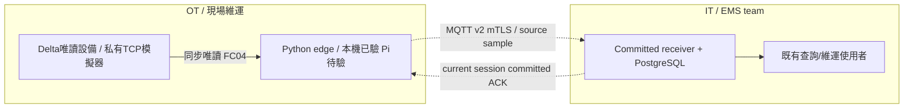
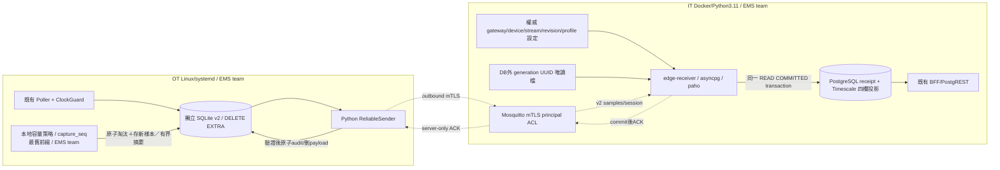
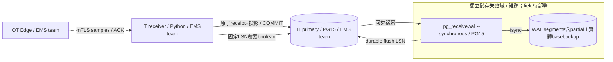

# v2 可靠送達子集架構

2026-11-13更新：[ADR-045](../adr/ADR-045-newest-first-edge-retention.md)核定量測最新優先，以下SQLite升本地schema3，wire仍2；容量壓力的最舊資料淘汰與中央committed分開，取代本文舊的cap停採敘述。[本輪驗證](../../output/newest-first-retention-20261113/README.md)。

2026-11-12；PRD-0021 §15.3／ADR-043。以下程式已在私有環境驗證，**共享 v1／原 24h 未切換**。Owner EMS；現場 Pi 及正式中央主機未部署驗收。維護入口見 [receiver README](../../services/edge-receiver/README.md)。

## C4 Context



## C4 Container



receiver 無對外 port、無 OT writer、無 Docker socket。v2 不走舊 Telegraf，不能同樣本雙發 v1；匿名 demo 與 field MQTT 必須為不同受控 topic plane。

## Data Flow

```mermaid
sequenceDiagram
 participant P as Edge/Poller
 participant Q as SQLite v2
 participant M as MQTT mTLS
 participant R as Receiver
 participant DB as PostgreSQL/Timescale
 P->>Q: UUID/hash/stream/seq/window/source time + snapshot commit
 Note over P,Q: schema3容量不足：最舊prefix淘汰＋新樣本同交易，失敗全回滾；不算committed
 P-)M: SUBSCRIBE ACK/session response; wait SUBACK
 P-)M: fresh challenge session request
 M-)R: authenticated gateway request
 R-)M: challenge + external generation
 M-)P: verified session
 P-)M: bounded original-ID sample
 M-->>P: PUBACK (keep queue)
 M-)R: v2 sample
 R->>R: schema/hash/authority/rate validation
 R->>DB: INSERT or obtain receipt, row lock
 R->>DB: re-read projection, insert/repair0 or compare1, conflict>1
 DB-->>R: transaction COMMIT returns
 R-)M: committed ID/hash/current session/batch
 M-)P: application ACK
 P->>Q: validate whole reply under session lock, audit + delete payload commit
```

DB 失敗、commit 結果不明、ACK 遺失：本地保留並原 ID 重送；相同 ID 異內容／同 stream-seq 異 ID／錯投影拒絕不覆寫。PITR 必須隔離 ACK、換 DB 外 generation、強制重連；本輪未驗實際 PITR。receipt／audit 暫不 purge，cap 滿停新採樣；多設備／完整對帳／20/s／Pi field 不在此驗收範圍。

## 2026-11-13 本地schema3資料模型與維護

同一SQLite仍有metadata／windows／queue／audit四表，metadata新增有界`retention` JSON；audit_sequence(capture_seq)及audit_window(window_id)為非唯一加速索引，供最舊排序及無引用窗口回收。schema2完整身份／metadata／quick_check通過後，在BEGIN IMMEDIATE同交易補必要摘要並升3；schema3缺摘要拒開。索引另用交易；僅SQLITE_FULL則完整回滾索引並warning retention_indexes_deferred，沿掃描查詢保持正確，下次重啟重試；無索引效能未驗收。若必要metadata也寫不下，升版回滾保留舊檔。wire schema與中央migration019不變，不是整個協定升v3。舊程式拒schema3；停止舊writer備份後升，禁止並行雙版本。

queue／audit cap取最舊截止seq，bytes遇SQLITE_FULL則重開完整交易，逐步擴大最舊前綴。retention摘要累積未確認副本／已確認audit／quarantine回收數與最近span／末筆ID/hash；不完整保留每筆歷史缺口，span不等於全段漏送。容量淘汰是本地行為，中央舊receipt／量測不刪；已淘汰ID的遲到ACK返回False不傷新ID。原子替換失敗時舊資料、窗口、計數與序號全回滾。上述更新取代前段的滿cap停新採樣條款，其他故障在資料未被本地容量淘汰前仍原ID補傳。

## 2026-11-13 sender內部公平排程（ADR-048）

[ADR-048](../adr/ADR-048-v2-live-backlog-fairness.md)在上方同一ReliableSender元件內採最新／最舊capture_seq成功1:1交替，初始latest；Q→S選擇依固定ASC／DESC，不以來源牆鐘劃live，不改sample內容或新增副本。只有當前authenticated committed ACK且本地原row成功resolved才換邊，其他失敗／retiredACK不消耗；S→Q刪除鎖與容量淘汰保持。無新服務／port／topic／schema或角色，Owner EMS；維護store.pending／sender.step，無新config key。Context與Container部署圖不變，DataFlow只改取pending的選擇。

輪次不持久，普通重連不重置，程序重啟從latest；反覆重啟或流量超吞吐不保證每筆時限。[私有1000舊＋3新](../../output/no-pi-restore-load-20261113/README.md)依原1秒edge節奏在1.044／2.091／2.098秒commit，最舊仍前進；非percentile／field SLA。真pg_dump/pg_restore新庫演練保留不可補範圍，非WAL PITR／RPO0；receiver200重複輸入queue64後恢復不假ACK。未切共享部署、用COM或重跑長測。

## 2026-11-13 ADR-049：同步WAL確認邊界

field ACK前須有獨立失效域WAL接收端即時fsync，維運依[WAL手冊](../../services/edge-receiver/WAL-PITR.md)完成TLS／專用複寫角色／basebackup。此為field新準入，私有QA以同宿主多容器驗單主庫失效，不表示正式部署。



```mermaid
sequenceDiagram
  participant R as Receiver
  participant P as Primary
  participant W as Independent WAL archive
  participant E as Edge
  R->>P: receipt+projection; SET LOCAL synchronous_commit=on
  P->>W: WAL
  W->>W: fsync
  W-->>P: flush LSN
  P-->>R: COMMIT returned
  R->>P: fixed current_wal_flush_lsn; required named peer flush≥LSN?
  P-->>R: True only
  R-)E: committed ACK
  Note over R,E: missing peer/timeout/unknown: retryable; keep original ID
```

Context新增IT維運的獨立archive，Container與DataFlow如上；migration020只增least-privilege boolean函式、無新增REST/topic，wire2/local schema3與sender公平不變。原架構中的「COMMIT即ACK」對field由本節取代。PITR須old-primary fencing、外generation與新session；缺WAL不得空庫重建或假達標。

## 2026-11-13 儲存一致性修復維護入口

同一SQLite schema3／既有元件內修bug，Context／Container／DataFlow連線與角色不變。開庫驗queue/audit關係與重複seq／現存audit高水位；enqueue同IMMEDIATE且淘汰前核seq/clock，retention溢位先拒；pending短BEGIN一致snapshot，選中payload對SQL/audit/window/hash；ACK在原write transaction再驗後才刪。新增第三個optional索引audit_time(sampled_at_us)，FULL時與原optional index transaction一起rollback/defer，正常兩個scalar MAX走不同index，無索引fallback scan。schema3/wire2／容量政策／sender公平／WAL guard保持，詳[PRD-0021 §15.11](../prd/PRD-0021-multi-device-edge-reliability.md)及[證據](../../output/no-pi-integrity-20261113/README.md)。非持續全庫掃描或完整舊備份回滾偵測，600k在Pi開庫耗時待驗。

### 2026-11-13 DB／WAL TLS與還原準入

沿原receiver→PostgreSQL與PostgreSQL→WAL archive連線，field雙向驗證TLS；WAL ACK須唯一同步ems_wal_archive、TLS＋client DN且flush覆蓋固定LSN。021新函式缺失拒絕，不回舊版。維運backup_preflight先tar layout／資源界限，再外置可信cluster ID＋checksum，最後PG真recovery至核定timeline／target；滿載保留原slot修復，不降級。依[ADR-050](../adr/ADR-050-database-tls-and-recovery-identity.md)，[55案／相鄰回歸證據](../../output/no-pi-wal-security-20261113/README.md)；元件及wire2/schema3不變，正式異失效域／Pi另驗。

2026-11-13：[ADR-051](../adr/ADR-051-pinned-recovery-and-slot-reseed.md) 僅補維運還原準入：外置核定timeline／target、slot先reserve→basebackup→新archive接手→真新鏈PITR驗證→generation換代／重新開ACK；沿原元件／資料流，無新增自動reseed/failover服務。中央資料滿與同ID分支短測已驗，[證據](../../output/no-pi-critical-closure-20261113/README.md)。
