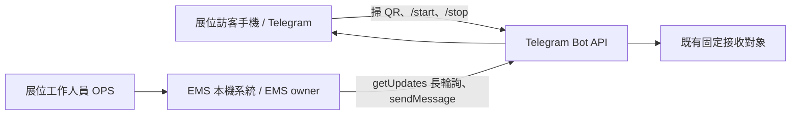
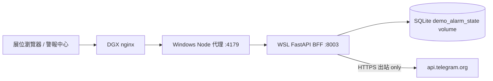
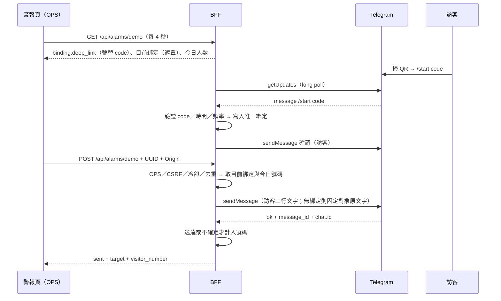

# PRD-0024：展位 QR Code 綁定 Telegram 訪客示範告警

Status: Implemented（2026-10-13 上線，使用者實機驗收）| Owner: EMS | 2026-10-13 | 決策：[ADR-036](../adr/ADR-036-telegram-visitor-binding-long-polling.md)
依 doc/PRD-架構設計-Guideline.md §2/3/4/10。修訂 [PRD-0019](PRD-0019-telegram-demo-alarm.md) 的「不提供任意接收者」Non-goal（使用者 2026-10-13 核准）；與 PRD-0004 Grafana 自動告警並存且互不影響。

## 1. Overview & Context
展位螢幕顯示 EMS 警報中心。訪客用手機掃 QR Code → Telegram 開啟 Bot（`t.me/<bot>?start=<code>`）→ 按「開始」即成為**唯一的目前綁定對象**（後掃者取代前一位）。工作人員按既有「觸發警報」按鈕，示範告警只送給該訪客，並告知其為今天第幾位觸發告警的客人。無有效綁定時維持 PRD-0019 原行為（固定對象、原訊息），讓工作人員隨時可示範。

## 2. Goals / Non-Goals
Goals：掃碼自助綁定、最新掃描者優先、10 分鐘到期、`/stop` 解除；台北日曆日不重複訪客計數並於午夜歸零；BFF 重啟不歸零；面板顯示遮罩後的綁定對象、QR、今日人數；隱私最小化。
Non-Goals：訪客名單或行銷名單、任意文字或收件者輸入框、Bot webhook／對外入站端點、多位同時綁定、設備控制或真實警報狀態變更、修改 Grafana contact point、展覽日期自動到期。

## 3. User Stories & Personas
- 展位訪客：掃碼後幾秒內收到確認，工作人員按鈕後在自己的 Telegram 收到示範告警；可輸入 `/stop` 取消。
- 展位工作人員（OPS，含 demo 帳號）：在警報中心看見 QR、目前綁定（遮罩）與今日人數，按一次發送；沒人綁定時仍可示範到固定對象。
- EMS 維運：可用設定開關立即關閉訪客綁定，並從狀態判斷 Bot 輪詢是否正常。

## 4. Functional Requirements
| ID | Requirement | Verification |
|---|---|---|
| FR-2401 | GET 狀態回傳 `binding.deep_link`（僅 state=ready）；code 為 128-bit 隨機值，每 60 秒輪替、每個有效 300 秒；只給 OPS session | unit codes + integration status |
| FR-2402 | 私人對話 `/start <有效 code>` → 取代既有綁定成為唯一綁定，Bot 回覆繁中確認；無 code／未知／過期 → 回覆重新掃描且不綁定 | unit updates |
| FR-2403 | 目前綁定者 `/stop` → 解除並回覆；其他人 `/stop` → 回覆「沒有綁定」且不影響現有綁定 | unit updates |
| FR-2404 | 綁定自綁定時刻起 600 秒到期，或被下一位取代即失效 | unit + integration |
| FR-2405 | 有效綁定時 POST 只送該訪客，固定三行文字「🚨 EMS 示範告警／您是今天第 N 位觸發告警的客人！／時間：YYYY-MM-DD HH:MM」（Asia/Taipei）；固定對象不收副本 | integration |
| FR-2406 | 無有效綁定 → PRD-0019 原文字送 `BFF_TELEGRAM_CHAT_ID`，不計數 | integration |
| FR-2407 | 計數：台北日曆日內不重複訪客；同訪客再次觸發沿用原號；午夜歸零。送達（ACK）或結果不確定（timeout）才計入；明確失敗釋放號碼 | unit store + integration |
| FR-2408 | 面板顯示「目前綁定：@da***」（無 username 時 first_name 首字＋`***`，皆無時「Telegram 訪客」）、剩餘時間、今日人數、Bot 狀態與 QR；「最近示範警報」預設 5 筆、可展開全部（最多 10） | Playwright mock E2E |
| FR-2409 | 綁定、今日計數、getUpdates offset 存於 BFF 專用 SQLite volume；重啟後保留 | integration restart |
| FR-2410 | Bot 更新只用 getUpdates long polling；webhook 已設定 → `webhook_active` 且不刪 webhook；409 → `conflict`；401/404 → `unauthorized` 停止；其他錯誤退避 | unit poller |
| FR-2411 | 只保存目前綁定（原始 chat id ≤ 綁定 TTL）與當日 keyed hash；午夜換 key 並刪除；log 不含 id／username／遮罩名稱 | unit store + log tests |
| FR-2412 | 保留 PRD-0019 保護：OPS + Origin、30 秒全域冷卻、UUID4 去重、Token 遮蔽、不接受收件者或文字 | 既有 + 新 integration |

## 5. Non-Functional Requirements
- 輪詢：long poll timeout 25 秒（1–50 可調）；啟動首次 timeout 0，數秒內進入 ready。網路／5xx 退避 1→60 秒；409 每 30 秒重試；webhook 每 300 秒重查。
- 綁定 TTL 600 秒（60–3600）；code 輪替 60 秒（15–600）、有效 300 秒（≥輪替、≤900）。
- 濫用限制（spec-locked）：超過 120 秒的 Telegram 訊息忽略；每位使用者 3 秒最多 1 個指令；全域 Bot 回覆每分鐘 ≤20。
- UI 每 4 秒輪詢狀態（分頁隱藏時暫停），低於代理每 IP 120 次／分鐘限制。
- SQLite：journal DELETE、synchronous FULL、secure_delete ON；目錄 0700、檔案 0600；單程序 flock，取得失敗 fail closed（綁定停用，固定對象示範仍可用）。
- 新增模組 unit/integration coverage ≥80%。

## 6. System Architecture
### 6.1 Context

### 6.2 Container

無新增容器或對外入站埠；只新增 BFF 背景輪詢任務與專用 volume。代理白名單不變（沿用 GET/POST /api/alarms/demo）。
### 6.3 Data Flow

## 7. Data Model
SQLite `/data/demo-alarm/state.sqlite3`（volume `demo_alarm_state`，僅 bff 掛載）：
| 表 | 欄位 | PII | 保留期 |
|---|---|---|---|
| `meta` | `day`（台北日期）、`day_key`（32 bytes 隨機）、`tg_offset` | 否 | day_key 午夜更換即銷毀 |
| `visitors` | `hash`（HMAC-SHA256(day_key, user id) 前 32 hex）、`number` UNIQUE | 假名化 | 當日；午夜刪除 |
| `binding` | `id=1`、`chat_id`、`display`（已遮罩）、`bound_at`、`expires_at` | 是（chat id、部分 username） | ≤ 綁定 TTL（預設 10 分鐘），到期／取代／`/stop` 即刪 |
輪替 code、每使用者頻率與最近 10 筆發送紀錄只在記憶體；最近紀錄只含 `target` 與 `visitor_number`，不含任何訪客識別。

## 8. API Contract
- `GET /api/alarms/demo`（OPS）：既有 `configured`、`cooldown_seconds`、`recent` 外新增 `binding`（功能關閉時為 null）：`{"state":"ready|starting|webhook_active|conflict|unauthorized|unavailable","deep_link":"https://t.me/<bot>?start=<code>"|null,"current":{"display":"@da***","expires_in_seconds":412}|null,"today":{"date":"2026-10-13","visitor_count":3}}`。`recent[]` 新增 `target`（visitor/default）、`visitor_number`（int/null）。
- `POST /api/alarms/demo`（OPS + Origin，body 仍只收 `request_id` UUID4）：200 新增 `target`、`visitor_number`；錯誤碼不變（401/403/409/422/429/502/503）。
- Bot 指令契約：`/start <code>` 綁定、`/start`（無效）回覆重新掃描、`/stop` 解除；只處理私人對話、非 bot、≤64 字。
- 代理（4178/4179/4181 系列）白名單不需變更。詳見 `api/openapi.yml` 2.2.0。

## 9. Security & Privacy
- 威脅：遠端拍照 QR 冒綁、Bot 被灌指令放大回覆、Token 隨輪詢 URL 進 log、多個 getUpdates 消費者衝突、個資外洩。
- 控制：code 輪替＋有效期＋訊息時效；遮罩名稱讓工作人員按鈕前可確認；每使用者／全域頻率限制；只接受私人對話；不自動 deleteWebhook；httpx URL 遮蔽並丟棄 getUpdates INFO 紀錄；錯誤一律固定碼不回傳 provider 內容；deep link 只給 OPS。
- 個資（個資法）：Bot 確認訊息告知「只暫存聊天 ID、到期即刪除」；原始 chat id ≤10 分鐘；訪客 hash 以當日隨機 key 假名化，午夜銷毀 key 與名單；secure_delete 清除已刪頁；log 只記事件類型。

## 10. Observability
log：`demo_binding state=<state>`（狀態變更才記）、`demo_binding bot=@<bot>`、`demo_binding event=bound|unbound|rejected`、`demo_alarm event_id=… target=visitor|default status=…`；不記 Token、chat id、username、遮罩名稱。面板顯示 Bot 狀態；排查見操作手冊。

## 11. Risks & Mitigations
| 風險 | 機率 | 衝擊 | 緩解 |
|---|---|---|---|
| 兩位訪客幾乎同時掃碼 | M | L | 後按 Start 者優先；面板顯示遮罩名稱，按鈕前確認 |
| 拍照 QR 遠端綁定 | L | M | 60 秒輪替／300 秒有效／120 秒訊息時效；名稱可見 |
| 其他程式輪詢同 Bot 或設定 webhook | L | M | 狀態顯示 conflict／webhook_active，QR 暫停，固定對象示範可用；不自動刪 webhook |
| BFF 容器 DNS／出站失敗 | L | M | 退避重試＋unavailable 狀態；上線前以同網路測試容器驗證 |
| 送出逾時但已送達 | M | L | 不確定也計號，避免兩人同號；同 UUID 不重送 |
| 個資保留過久 | L | H | TTL 刪除、午夜換 key、secure_delete、無 id log |
| Bot 被濫發指令 | M | L | 頻率限制、私人對話限定、回覆上限 |
| session 8 小時上限 | M | L | 長展期間重新登入一次（面板顯示登入表單） |

## 12. Rollout & Migration Plan
1. RED→GREEN（pytest、mock E2E）。2. 以同一 image `ems-bff:booth-preprod` 啟動隔離測試容器（127.0.0.1:4292、Origin http://127.0.0.1:4291、功能開啟、拋棄式 volume），使用者用自己的 Telegram 完成驗收（上線閘門）。3. 停止測試容器（getUpdates 只允許單一消費者）後才重建正式 BFF（`--no-build` 使用已驗收 image；會清除既有 session）。4. 切換 UI release、使用者重啟代理、上線後再做一次手機煙霧測試。
回復：`bff.toml` 設 `demo_bind_enabled = false` 後重啟 BFF（立即回到 PRD-0019 行為）；或重標 `ems-bff:before-booth-qr-20261013`；UI 切回 `20260929-sampling-lines-v1`。不需資料遷移；volume 可保留或刪除。

## 13. Test Strategy
- Unit：store（schema、午夜換 key、hash）、code／遮罩、Bot 指令處理（綁定、取代、過期、/stop、過濾、時效、頻率）、poller（offset、webhook、409、401、退避、log 遮蔽）。
- Integration（ASGI + MockTransport + tmp SQLite）：訪客三行文字與台北時間、同訪客同號、新訪客 +1、無綁定原文字不計數、到期回退、單次發送無副本、GET 遮罩與無秘密、失敗／逾時計號、重啟保留、單程序鎖。
- E2E：Playwright 全 mock（QR、綁定、展開全部、舊 BFF 相容、RWD）；真實 Telegram 只由使用者在預備環境與上線後手動驗收，自動測試不發真訊息。

## 14. Open Questions
無阻塞事項。使用者 2026-10-13 決議：下載 uqr@0.1.3（MIT）作為前端 QR 產生器；允許預備測試容器；docker-compose 僅新增 volume，免跑 pipeline E2E（理由見附錄）；略過 agent 審查並記錄缺口。

## 15. Appendix
**Guideline §10 自查**：Goals/Non-Goals 分離 ✅；FR 編號可追溯 ✅；NFR 量化 ✅；三張圖 ✅；PII 與保留期 ✅；API Contract 同步 `api/openapi.yml`（本專案對應 doc/API.yaml）✅；風險 ≥5 ✅；上線與回滾 ✅；三層測試 ✅；Open Questions ✅；architect 與 security-reviewer agent 審查 ❌——使用者 2026-10-13 明確決定略過（與 PRD-0019 相同處理），以 rubric 式自查、ASGI 安全測試與使用者實機驗收替代，未宣稱 agent 審查通過。
**project_rules §8 例外**：`docker-compose.yml` 只為 bff 新增一個具名 volume，未改任何採集 pipeline 服務、port 或網路；以 `docker compose config` 驗證、BFF 全套測試與上線煙霧測試替代 pipeline E2E（使用者 2026-10-13 核准）。
**變更紀錄**：2026-10-13 建立。
**上線紀錄（2026-10-13）**：
- 測試：BFF 309 passed、1 skipped，整體 coverage 90%（新模組 codes／store 100%、service 86%、poller 88%）；UI mock E2E 14/14、QR 單元測試 6/6；自動測試皆未發送真實 Telegram。
- 預備環境：同一 image `ems-bff:booth-preprod`（bb8f2c7e2fac）的隔離容器（127.0.0.1:4292，測試代理 4291），使用者以自己的手機完成驗收 11/11（含重啟後綁定與計數保留），結束後已移除容器與拋棄式 volume。
- 正式上線：約 14:57（+08:00）由使用者將正式 bff 切換為已驗收 image；回退標籤 `ems-bff:before-booth-qr-20261013`（73da42667420）；UI release `20261013-booth-qr-v1` 由使用者重啟代理上線。
- 插曲：第一次 retag 未生效，bff 以舊 image 重建；唯讀 smoke 檢出（容器內無 demo_binding 套件、log 無狀態）後使用者重跑 retag 與重建。第二次 smoke 全數通過（image 相符、`demo_binding state=ready`、:8003 與公開網址 401、log 無 Token、volume 已掛載、其他 16 個容器 ID 與啟動時間未變），使用者正式站手機測試通過。
